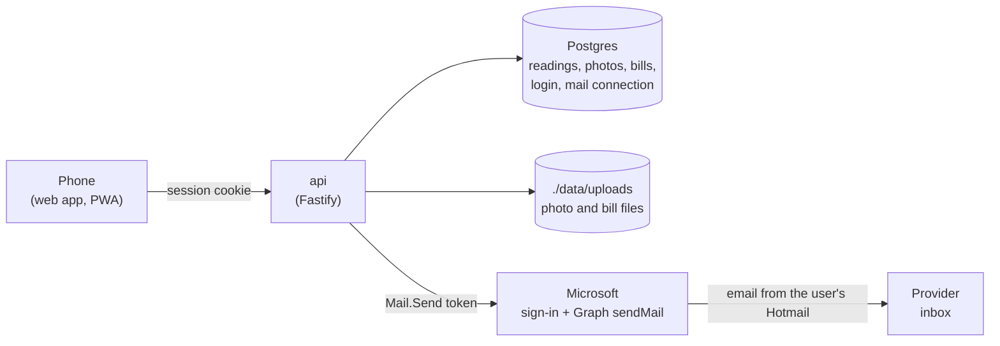
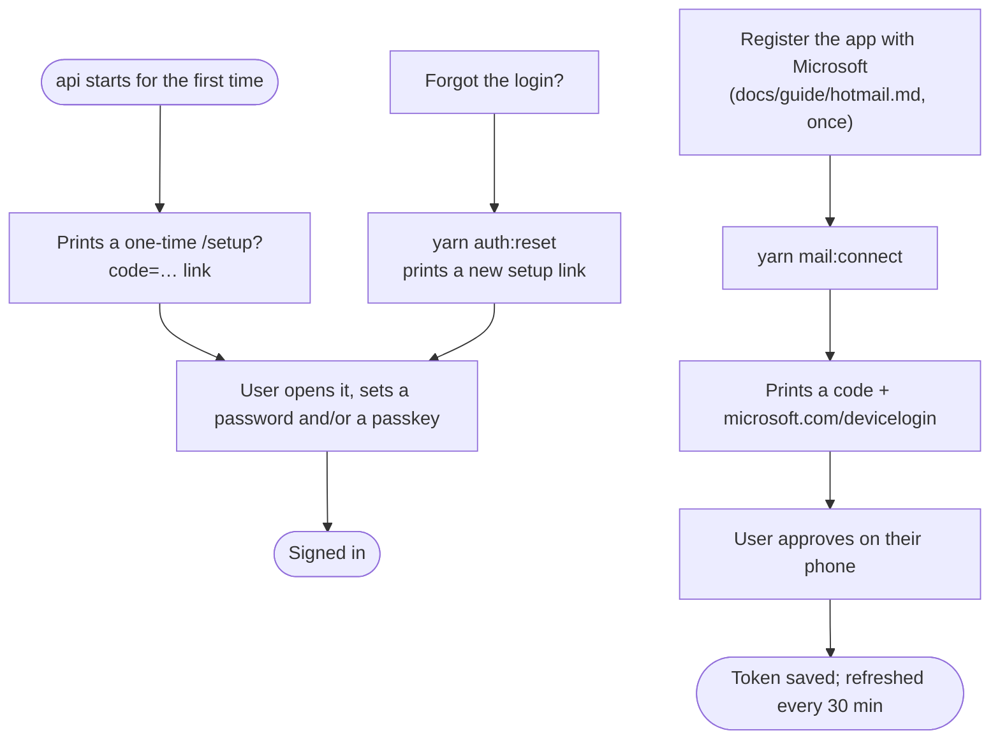
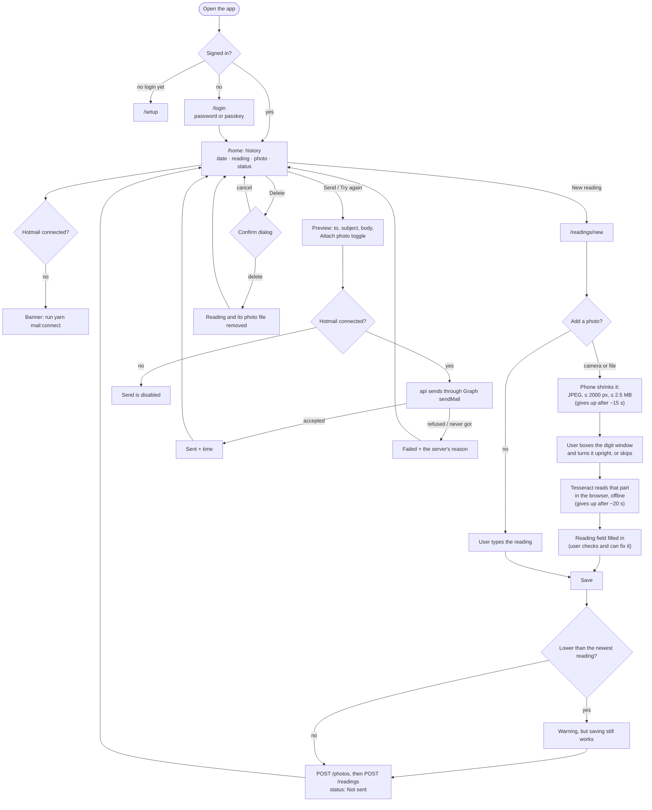
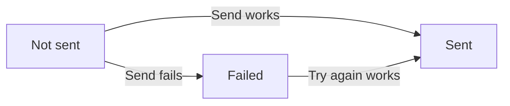

# How Meter Reader works

Words follow `docs/GLOSSARY.md`. Decisions behind the flow are in `docs/adr/`.

## The pieces

## One-time setup (on the server)

## Taking and sending a reading

## A reading's status

Every reading starts as **Not sent**. Sending moves it to **Sent** or **Failed**. A failed one can be tried again.

If Try again fails too, the reading stays **Failed**. Any reading can be deleted, whatever its status.
